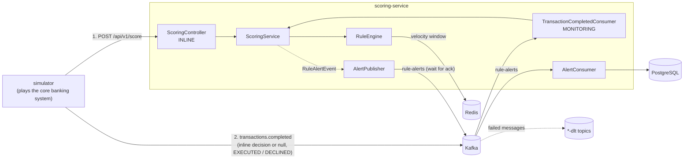

# Fraud Sentinel

A real-time transaction fraud detection system in Java, modelled on how banks and payment platforms check transactions twice: **inline**, before the payment is approved, and in **post-transaction monitoring**, after it has been executed.

Inline, every transaction gets a risk score from a set of independent rules and one of three decisions: **APPROVE**, **REVIEW** or **BLOCK**, together with machine-readable reason codes (`AMT_HIGH`, `TIME_NIGHT`, `VEL_BURST`). Non-approved transactions become alerts that analysts pick up, investigate and close as confirmed fraud or false positive; those outcomes feed back into per-rule precision.

> **Status:** work in progress. A personal learning project. All data is synthetic, generated by the included simulator.

## Architecture



The simulator behaves like a core banking system:

1. It asks for an **inline decision** over REST while the customer is waiting.
2. It executes or declines the payment: `BLOCK` → declined, `APPROVE` / `REVIEW` → executed (a real system would step up authentication on `REVIEW`). If the fraud service does not answer (down, timeout, 503), its **fallback policy** lets small payments (≤ 5,000,000 VND) through unscored and declines larger ones.
3. It publishes a **completed-transaction event** to Kafka carrying the inline decision (or `null`) and the outcome.

The two stages have different jobs:

| | Inline (REST) | Monitoring (Kafka) |
|---|---|---|
| When | Before the payment, customer waiting | After the payment was executed or declined |
| Can stop this payment | Yes | No |
| Rules run | `INLINE` rules: fast, single lookups | `MONITORING` rules; plus a **catch-up** run of the `INLINE` rules when the payment was never scored |
| Output | APPROVE / REVIEW / BLOCK to the caller, alert if not approved | Alert only, marked with whether funds have already moved |

Today the monitoring stage's main job is the catch-up: payments that slipped through unscored during a fraud-service outage are scored as soon as the service is back (the events wait in Kafka), and any hit becomes an alert flagged `fundsMoved = true` so analysts know recovery is urgent. Monitoring-only rules (wide windows, cross-account patterns) and flags that feed the inline stage come next in the roadmap.

## Rules

| Code | Rule | Default | Score |
|---|---|---|---|
| `AMT_HIGH` | Amount above threshold | > 50,000,000 VND | 60 |
| `TIME_NIGHT` | Transaction at night, Vietnam local time | 01:00–04:00 | 20 |
| `VEL_BURST` | Too many transactions per account in a sliding window | > 5 in 60 s | 50 |

Scores are summed (capped at 100): **≥ 80 → BLOCK**, **≥ 50 → REVIEW**, otherwise **APPROVE**. Each rule's on/off switch, score and parameters live in the `rule_config` table and can be changed at runtime through `PUT /api/v1/rules/{code}`; the decision thresholds live in `application.yaml`.

## Design decisions

**Pluggable rule engine.** Each rule is a Spring component implementing `Rule` and declares the stages it runs in (`INLINE` by default, `MONITORING` for heavier rules). The engine receives every `Rule` bean automatically, so adding a rule means adding one class. Each rule runs inside its own `try/catch`: if one fails (for example Redis is down), it is skipped and the transaction still gets a decision instead of an error. Rules are pure functions of the transaction and their typed parameters, so they are unit-tested without Spring.

**Rule configuration in the database, hot-reloaded.** Postgres is the source of truth; each instance keeps an immutable in-memory snapshot, so scoring never queries the database. The snapshot is loaded at startup (the service refuses to start without it, rather than run with no rules), refreshed every 10 s, and reloaded immediately after an update. It is swapped with a single `volatile` assignment (copy-on-write), so the hot path needs no locks and never sees a half-applied change. If a refresh fails the previous snapshot stays in force; if one rule's parameters are invalid only that rule keeps its previous config. Parameters are validated by the rule's own typed record before anything is saved. Updates carry the version the client last read and are rejected with **409** if someone changed the rule in between, and every change is recorded in `rule_config_audit`.

**Sliding-window velocity on Redis.** Each account has a sorted set (`vel:acc:{accountId}`) with the transaction ID as member and the timestamp as score. One Lua script trims expired entries, adds the current transaction, refreshes the TTL and counts the window:
- *Atomic*: Redis runs the script as a single unit, so concurrent requests for the same account cannot interleave and miscount. It is also one network round-trip instead of four.
- *Idempotent*: re-sending the same transaction updates the existing member instead of adding a new one, so retries are never double-counted.
- *Fail-fast*: a 200 ms Redis timeout keeps a Redis outage from stalling the API.

**Kafka partitioned by account.** Messages are keyed by `accountId`, so all transactions of one account land on the same partition and are processed in order by one consumer, which is what the velocity rule needs. Because the same account's events stay in order, a catch-up run after an outage rebuilds the velocity window in the right sequence.

**At-least-once, made safe by idempotency.** Every Kafka send waits for the broker acknowledgement before the listener returns, so an offset is only committed after its outputs are durable. A consumer can still crash after publishing but before committing, so an event may be processed twice. That is harmless here: velocity is keyed by transaction ID and alerts are unique per `(txn_id, stage)`, so one payment can carry at most one inline and one monitoring alert.

**No decision without a record.** A REVIEW or BLOCK decision is only returned after its alert has been acknowledged by Kafka (`rule-alerts`). If that fails, the REST API answers **503 within ~3 s** (tight producer timeouts) instead of returning an unrecorded decision; the caller's fallback policy then applies and the monitoring stage scores the payment afterwards. On the Kafka path a failed alert publish is retried. A separate consumer group (`alert-writer`) persists alerts, so a database outage delays alert storage without losing alerts or slowing scoring.

**Dead-letter topics.** Failures are classified: malformed JSON and invalid transactions go straight to `transactions.completed-dlt` (retrying cannot fix them), while transient failures such as a database blip are retried twice before landing in `<topic>-dlt`. A single bad message therefore never blocks its partition, and failed messages keep their error details in headers for later replay.

**Schema owned by Flyway.** Hibernate only validates (`ddl-auto: validate`); every schema change is a versioned SQL migration.

**Case management with a guarded workflow.** An alert moves `OPEN → IN_REVIEW → CONFIRMED_FRAUD | FALSE_POSITIVE` (or back to `OPEN` on release). The transition rules live in the `Alert` entity itself, which has no setters, so no code path can skip a step; only the assigned analyst can resolve or release. Every transition is written to an append-only audit table in the same transaction as the status change.

**Optimistic locking for analyst actions.** Two analysts opening the same alert both see `OPEN`, so the in-memory status check alone cannot stop a double assignment. A `@Version` column makes the second commit update zero rows and fail with **409**, proven by an integration test that replays exactly that stale-copy race. Optimistic locking fits here because analyst actions are human-paced and rarely contend; holding a database lock while someone reads a case would not be workable.

**Feedback loop.** `GET /api/v1/alerts/stats/rules` splits each resolved alert by reason code and reports, per rule, how many hits were confirmed versus false positives (precision), which is what threshold tuning is based on.

**Times stored in UTC.** Local time is derived only where the business rule needs it (`TIME_NIGHT` converts to `Asia/Ho_Chi_Minh`).

## Tech stack

Java 21 · Spring Boot 4 · Apache Kafka 4.1 (KRaft) · Redis 7 · PostgreSQL 16 · Flyway · Docker Compose

## Getting started

**Prerequisites:** JDK 21 and Docker.

```bash
# 1. Infrastructure
docker compose up -d

# 2. Scoring service (creates the Kafka topics). Start it first.
cd scoring-service && ./mvnw spring-boot:run

# 3. Simulator, in another terminal
cd simulator && ./mvnw spring-boot:run
```

On Windows use `mvnw.cmd` instead of `./mvnw`.

### Score a transaction over REST

```bash
curl -X POST http://localhost:8081/api/v1/score \
  -H "Content-Type: application/json" \
  -d '{"txnId":"T001","accountId":"ACC001","amount":75000000,"currency":"VND",
       "channel":"MOBILE","timestamp":"2026-10-15T19:30:00Z"}'
```

```json
{"txnId":"T001","score":80,"decision":"BLOCK","reasons":["AMT_HIGH","TIME_NIGHT"]}
```

### Inspect the results

```bash
# Open alerts
curl http://localhost:8081/api/v1/alerts

# Completed-transaction events published by the simulator
docker exec -it fs-kafka /opt/kafka/bin/kafka-console-consumer.sh \
  --bootstrap-server localhost:9092 --topic transactions.completed --property print.key=true

# Outage drill: stop scoring-service for ~1 minute while the simulator runs, start it again,
# then look for monitoring alerts on payments that went through unscored
docker exec -it fs-postgres psql -U fraud -d fraud \
  -c "select txn_id, stage, funds_moved, decision, reasons from fraud_alert where stage = 'MONITORING';"

# Work a case (identity comes from the X-Analyst-Id header)
curl -X POST http://localhost:8081/api/v1/alerts/1/assign -H "X-Analyst-Id: alice"
curl -X POST http://localhost:8081/api/v1/alerts/1/resolve -H "X-Analyst-Id: alice" \
  -H "Content-Type: application/json" -d '{"outcome":"CONFIRMED_FRAUD","note":"customer confirmed"}'
curl http://localhost:8081/api/v1/alerts/1/history
curl http://localhost:8081/api/v1/alerts/stats/rules

# Alerts grouped by reason
docker exec -it fs-postgres psql -U fraud -d fraud \
  -c "select reasons, decision, count(*) from fraud_alert group by 1, 2 order by 3 desc;"
```

## Project structure

```
fraud-sentinel/
├── docker-compose.yml        PostgreSQL, Redis, Kafka
├── scoring-service/
│   └── com.fraudsentinel.scoring
│       ├── api/              REST entry point
│       ├── messaging/        completed-transaction consumer, topics, dead-letter handling
│       ├── scoring/          inline scoring and post-transaction monitoring
│       ├── rule/             Rule interface, RuleEngine, rule implementations
│       ├── feature/          Redis velocity store (+ Lua script in resources)
│       ├── alert/            alert publishing and persistence, case workflow, audit, rule stats
│       └── config/           typed configuration (FraudProperties)
└── simulator/                synthetic traffic with labelled fraud scenarios
```

## Known limitations

These are deliberate next steps, not oversights:

- **Analyst identity is trusted from a request header.** `X-Analyst-Id` is not authenticated yet; Spring Security with JWT is planned. Confirming fraud also has no second approver (maker-checker) yet.
- **Rule changes reach other instances by polling.** An update applies immediately on the instance that received it and within one refresh interval (10 s) elsewhere; a push notification (e.g. Redis Pub/Sub) with polling kept as a safety net would shorten that gap.
- **Short fixed retry before dead-lettering alerts.** A long database outage moves alerts into `rule-alerts-dlt` instead of waiting; an exponential back-off and a replay tool are planned.
- **No monitoring-only rules yet.** All current rules are `INLINE`, so the monitoring stage only does catch-up scoring for unscored payments. Wide-window and cross-account rules, and flags they set for the inline stage, are next.
- **Simplified core behaviour.** The simulator treats `REVIEW` as executed; a real core would step up authentication first. For monitoring alerts the `decision` column means risk level (REVIEW = medium, BLOCK = high), not an approval decision.
- **Event time is trusted.** The velocity window uses the transaction's own timestamp; a production system would reject timestamps that drift too far from server time.

## Roadmap

- [x] Pluggable, config-driven rule engine
- [x] Redis sliding-window velocity rule
- [x] Alert persistence with Flyway
- [x] Kafka pipeline and transaction simulator
- [x] Durable alerts via Kafka and dead-letter topics
- [x] Case management: assign, release, resolve, audit trail, per-rule precision
- [x] Rules stored in the database: enable, disable and retune without redeploying
- [ ] More velocity features (amount per 1 h / 24 h, new recipients, accounts sharing a device) and the rules built on them: new device + high value, impossible travel, card testing, blacklist, night activity unusual for the account
- [ ] Shadow mode: run a new rule version alongside the live one without affecting decisions
- [ ] Observability: Micrometer, Prometheus, Grafana (p99 scoring latency, false-positive rate from the simulator's scenario labels)
- [ ] Graph-based detection of mule-account rings
- [ ] (Optional) ML score combined with rule score
