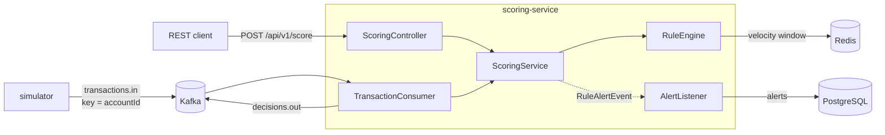

# Fraud Sentinel

A real-time transaction fraud detection system in Java, modelled on how banks and payment platforms score transactions before approving them.

Every transaction gets a risk score from a set of independent rules and one of three decisions: **APPROVE**, **REVIEW** or **BLOCK**, together with machine-readable reason codes (`AMT_HIGH`, `TIME_NIGHT`, `VEL_BURST`). Non-approved transactions become alerts stored for analyst follow-up.

> **Status:** work in progress. A personal learning project. All data is synthetic, generated by the included simulator.

## Architecture



- **Two entry points, one scoring path.** A synchronous REST API (the approve-before-payment flow) and an asynchronous Kafka consumer (post-transaction monitoring) both call the same `ScoringService`.
- **Simulator** is a separate Spring Boot app that plays the role of an upstream core system. It produces normal traffic mixed with labelled fraud scenarios.

## Rules

| Code | Rule | Default | Score |
|---|---|---|---|
| `AMT_HIGH` | Amount above threshold | > 50,000,000 VND | 60 |
| `TIME_NIGHT` | Transaction at night, Vietnam local time | 01:00–04:00 | 20 |
| `VEL_BURST` | Too many transactions per account in a sliding window | > 5 in 60 s | 50 |

Scores are summed (capped at 100): **≥ 80 → BLOCK**, **≥ 50 → REVIEW**, otherwise **APPROVE**. All thresholds, scores and on/off switches live in `application.yaml`.

## Design decisions

**Pluggable rule engine.** Each rule is a Spring component implementing `Rule`. The engine receives every `Rule` bean automatically, so adding a rule means adding one class. Each rule runs inside its own `try/catch`: if one fails (for example Redis is down), it is skipped and the transaction still gets a decision instead of an error.

**Sliding-window velocity on Redis.** Each account has a sorted set (`vel:acc:{accountId}`) with the transaction ID as member and the timestamp as score. One Lua script trims expired entries, adds the current transaction, refreshes the TTL and counts the window:
- *Atomic*: Redis runs the script as a single unit, so concurrent requests for the same account cannot interleave and miscount. It is also one network round-trip instead of four.
- *Idempotent*: re-sending the same transaction updates the existing member instead of adding a new one, so retries are never double-counted.
- *Fail-fast*: a 200 ms Redis timeout keeps a Redis outage from stalling the API.

**Kafka partitioned by account.** Messages are keyed by `accountId`, so all transactions of one account land on the same partition and are processed in order by one consumer, which is what the velocity rule needs. Malformed or invalid messages are logged and skipped instead of blocking the partition (poison-pill handling).

**At-least-once, made safe by idempotency.** A consumer can crash after publishing a decision but before committing its offset, so a transaction may be scored twice. That is harmless here: velocity is keyed by transaction ID and alerts have a `UNIQUE (txn_id)` constraint.

**Schema owned by Flyway.** Hibernate only validates (`ddl-auto: validate`); every schema change is a versioned SQL migration.

**Times stored in UTC.** Local time is derived only where the business rule needs it (`TIME_NIGHT` converts to `Asia/Ho_Chi_Minh`).

## Tech stack

Java 21 · Spring Boot 4 · Apache Kafka 4.1 (KRaft) · Redis 7 · PostgreSQL 16 · Flyway · Docker Compose

## Getting started

**Prerequisites:** JDK 21 and Docker.

```bash
# 1. Infrastructure
docker compose up -d

# 2. Scoring service (creates the Kafka topics). Start it first.
cd scoring-service && ./mvnw spring-boot:run

# 3. Simulator, in another terminal
cd simulator && ./mvnw spring-boot:run
```

On Windows use `mvnw.cmd` instead of `./mvnw`.

### Score a transaction over REST

```bash
curl -X POST http://localhost:8081/api/v1/score \
  -H "Content-Type: application/json" \
  -d '{"txnId":"T001","accountId":"ACC001","amount":75000000,"currency":"VND",
       "channel":"MOBILE","timestamp":"2026-10-15T19:30:00Z"}'
```

```json
{"txnId":"T001","score":80,"decision":"BLOCK","reasons":["AMT_HIGH","TIME_NIGHT"]}
```

### Inspect the results

```bash
# Open alerts
curl http://localhost:8081/api/v1/alerts

# Decisions produced by the Kafka pipeline
docker exec -it fs-kafka /opt/kafka/bin/kafka-console-consumer.sh \
  --bootstrap-server localhost:9092 --topic decisions.out --property print.key=true

# Alerts grouped by reason
docker exec -it fs-postgres psql -U fraud -d fraud \
  -c "select reasons, decision, count(*) from fraud_alert group by 1, 2 order by 3 desc;"
```

## Project structure

```
fraud-sentinel/
├── docker-compose.yml        PostgreSQL, Redis, Kafka
├── scoring-service/
│   └── com.fraudsentinel.scoring
│       ├── api/              REST entry point
│       ├── messaging/        Kafka consumer, topic config
│       ├── scoring/          score aggregation and decision
│       ├── rule/             Rule interface, RuleEngine, rule implementations
│       ├── feature/          Redis velocity store (+ Lua script in resources)
│       ├── alert/            alert entity, listener, query API
│       └── config/           typed configuration (FraudProperties)
└── simulator/                synthetic traffic with labelled fraud scenarios
```

## Known limitations

These are deliberate next steps, not oversights:

- **Alerts are written asynchronously in memory (`@Async`).** If the service dies between returning a decision and saving the alert, that alert is lost. Planned fix: publish alerts to a Kafka topic or use a transactional outbox.
- **Rule thresholds need a restart to change.** Planned: rules stored in the database with versioning and hot reload.
- **No dead-letter topic yet.** Bad messages are only logged.
- **Event time is trusted.** The velocity window uses the transaction's own timestamp; a production system would reject timestamps that drift too far from server time.

## Roadmap

- [x] Pluggable, config-driven rule engine
- [x] Redis sliding-window velocity rule
- [x] Alert persistence with Flyway
- [x] Kafka pipeline and transaction simulator
- [ ] Durable alerts (Kafka or outbox) and dead-letter topic
- [ ] Case management: assign, resolve and audit trail for analysts
- [ ] Rule hit-rate and false-positive measurement using the simulator's scenario labels
- [ ] Observability: Micrometer, Prometheus, Grafana (p99 scoring latency)
- [ ] Rules stored in the database with shadow mode for safe rollout
